# Tally Financial Intelligence (TFI)

[](https://fastapi.tiangolo.com)
[](https://react.dev/)
[](https://tallysolutions.com/)
[](https://www.mysql.com/)
[](https://redis.io/)
[](https://ai.google.dev/)

An enterprise-grade financial intelligence engine, real-time dashboard, and deterministic AI assistant that connects directly to **Tally Prime** via its native XML/HTTP interface.

Instead of navigating complex multi-level menus in desktop Tally, leadership and operational teams get instant access to live financial metrics, drill-down inventory tracking across godowns, audited financial statements, and a natural-language AI assistant backed by real accounting records.

---

## Architecture Overview & End-to-End Request Flow

```mermaid
flowchart LR
    %% Ingestion
    Client["🖥️ React 19 Client SPA\n(Dashboard • Reports • AI Chat)"]
    Gateway["🛡️ FastAPI Gateway\n(CORS • CSRF • RBAC)"]
    MySQL[("🗄️ MySQL 8 Database\n(Users • Roles • Scope)")]
    Router{"Route\nClassifier"}

    Client -->|"HTTPS + JWT + CSRF"| Gateway
    Gateway <-->|"Session & RBAC"| MySQL
    Gateway -->|"Dispatch"| Router

    %% Branch A: Financial & Inventory Reports
    Router -->|"Reports / Inventory"| SWR{"Redis SWR\nCache"}
    SWR -->|"Fresh Hit (<300s)"| Deliver["⚡ Response Delivery\n(Instant Cached / Audited JSON)"]
    SWR -->|"Miss / Revalidate"| TDL["📄 Dynamic TDL\nXML Generator"]
    TDL -->|"HTTP POST (Port 9000)"| Tally[("🏢 Tally Prime ERP\n(Native C++ Core)")]
    Tally -->|"Raw TDL XML"| Parser["📊 High-Precision\nXML Parser"]
    Parser -->|"Write-through & Deliver"| Deliver

    %% Branch B: Deterministic AI Assistant
    Router -->|"Natural Language"| Guard["🛑 Safety Interceptor\n(Regex Write Blocker)"]
    Guard -->|"Read-only"| Gemini["🤖 Google Gemini 2.5\n(13 Read-Only Tools)"]
    Gemini -->|"Tool Payload"| Tools["⚙️ Tool Dispatcher\nEngine"]
    Tools -->|"Live Ground Truth"| Tally
    Tools -->|"Audited Figures"| Deliver

    %% Final Presentation
    Deliver --> UI["📈 Interactive UI Views\n(Statements • Godown Vouchers • AI Chat)"]
```



### Architecture Hierarchy Breakdown

| Tier | Component | Responsibilities & Architectural Guarantees |
| :--- | :--- | :--- |
| **Tier 1: Presentation** | **React 19 SPA** | Single-page application providing real-time financial dashboards, audited statements, godown/stock voucher drill-downs, and natural-language AI chat. Secured via HttpOnly cookies and SameSite CSRF tokens. |
| **Tier 2: Gateway & Security** | **FastAPI + MySQL 8** | Enforces zero-trust multi-tenancy, JWT session validation, role-based permission bitmasks (`superadmin`, `admin`, `user`), and PBKDF2-HMAC-SHA256 password hashing. |
| **Tier 3: Core Intelligence** | **SWR Caching & Gemini AI** | Routes requests between cached financial pipelines and the deterministic AI assistant. AI is restricted to 13 read-only tools with zero hallucination. Cache delivers fresh data in `<1ms` and revalidates stale records asynchronously. |
| **Tier 4: ERP Gateway** | **Tally Prime (Port 9000)** | Direct integration with Tally Prime's native C++ accounting core over HTTP/XML without intermediary ODBC bridges or lossy approximations. |
| **Tier 5: Precision Parsing** | **Native XML Parser** | Ingests raw TDL XML responses and calculates exact closing decimals, voucher ledger movements, and stock batches matching Tally desktop reports to 100% precision. |


### Architectural Highlights & Resilience Pillars

| Pillar | Engineering Design | Guarantee |
| :--- | :--- | :--- |
| **Zero-Trust Security** | Dual-cookie architecture (`access_token` + rotating `refresh_token`), SameSite protection, CSRF token validation, and PBKDF2-HMAC-SHA256 (310k iterations). | Sessions are resistant to XSS, CSRF, and replay attacks across tenant boundaries. |
| **High-Throughput Caching** | Multi-tier **Stale-While-Revalidate (SWR)** caching in Redis with proactive background pre-warming. | Sub-millisecond latency for heavy inventory matrices and drill-down reports. |
| **High Availability & Fail-Open** | If Redis or the AI service encounters downtime, the circuit automatically **fails open**. | Zero downtime: requests bypass failed tiers and pull directly from Tally Prime without 500 errors. |
| **Zero Hallucination AI** | Gemini only performs **intent detection and parameter extraction**. Accounting figures are fetched directly from Tally XML. | The LLM never computes, estimates, or invents financial numbers. |
| **Direct ERP Native Integration** | Communicates with Tally Prime's C++ accounting engine over raw XML/TDL protocol (`<ID>Item Monthly Summary</ID>`, `<ID>Godown Vouchers</ID>`). | 100% precision matching Tally Prime desktop reports to the exact decimal without lossy Python approximations. |

---

## Tech Stack

| Layer | Technologies & Libraries | Purpose |
| :--- | :--- | :--- |
| **Backend Framework** | **Python 3.13.5**, **FastAPI**, **Uvicorn** | High-performance asynchronous REST API backend |
| **Accounting Integration** | **Tally Prime**, **Tally XML / TDL Interface** | Real-time source of truth via local HTTP/XML gateway (port 9000) |
| **Database & Persistence** | **MySQL 8.0.41**, `mysql-connector-python` | Multi-tenant organizations, users, RBAC roles, permissions, and sessions |
| **Caching & Acceleration** | **Redis-py 8.1.0**| Stale-While-Revalidate (SWR) caching layer with background warming daemon |
| **Artificial Intelligence** | **Google Gemini** (`google-genai`), OpenRouter (fallback) | Deterministic intent classification and read-only tool selection |
| **Security & Auth** | **JWT**, **PBKDF2-HMAC-SHA256**, SameSite Cookies, CSRF | Zero-trust authentication with 310,000 hash iterations & HttpOnly cookies |
| **Frontend Framework** | **React 19**, **Vite** | Modern, reactive single-page dashboard application |
| **Routing & UI** | **React Router 7**, **Lucide Icons** | Client-side routing, drill-down navigation, and responsive financial UI |
| **Testing & Quality** | **Pytest**, `pytest-asyncio`, `pytest-mock` | Comprehensive backend test coverage (parsers, builders, RBAC, calculations) |

---

## Core Capabilities

### 1. Executive Financial Intelligence
* **Live Financial Dashboard**: Executive summary covering gross revenue, operating expenses, net profit, total receivables, total payables, and pending purchase/sales bills.
* **Profit & Loss**: Date-filtered statement mapping trading accounts, direct expenses, gross profit, indirect overheads, and net profit.
* **Balance Sheet**: Dual-sided balance sheet (Sources of Funds vs. Application of Funds) reflecting live ledger positions.
* **Trial Balance**: Complete debit/credit trial balance with drill-down support to child groups and ledgers.
* **Cash & Bank Position**: Live liquid balances broken down across verified banking ledgers and physical cash accounts.

### 2. Working Capital & Outstanding Analysis
* **Bills Receivable & Payable**: Complete itemized bill tracking with reference numbers, overdue aging buckets (0–30, 31–60, 61–90, 90+ days), and credit period tracking.
* **Party Ledger Outstanding**: Scoped views per customer or vendor with bill allocation histories.

### 3. Inventory & Godown Intelligence (Native TDL Engine)
* **Stock Summary**: Group-by-group stock hierarchy directly matching Tally Prime valuations.
* **Godown Summary**: Multi-godown tracking (e.g. *Main Location*, regional godowns) reporting actual closing quantities, rates, and values.
* **Godown Monthly Summary**: Native 12-month inward, outward, and closing quantity/value matrix fetched directly from Tally's native `<ID>Item Monthly Summary</ID>` report (not synthesized Python calculations).
* **Stock Item & Godown Vouchers**: Exact replication of Tally Prime's voucher register showing:
  * Opening balance
  * Inward & Outward quantities/values per voucher (Stock Journals, Material In/Out, Receipt/Delivery Notes, Rejections, Invoices)
  * Running closing balance
  * Period totals

### 4. Deterministic AI Financial Assistant
* **Zero Hallucination Guarantee**: Gemini is strictly constrained to **intent classification and tool selection** across 13 read-only financial tools.
* **Strict Read-Only Enforcement**: A deterministic regex policy interceptor blocks any write/update/delete requests before the LLM is ever contacted.
* **Deterministic Numbers**: Financial values and voucher totals are fetched directly from Tally's XML engine and passed to a deterministic formatter. The LLM never invents numbers.

### 5. Multi-Tenant Role-Based Access Control (RBAC)
* **Organizations**: Multi-tenant database schema (`organizations`) allowing complete data isolation.
* **Role Hierarchy**: Structured `superadmin` > `admin` > `user` hierarchy.
* **Granular Permissions**: Scoped permission keys (`financial`, `inventory`, `banking`, `tax`).
* **Enterprise Security**:
  * Passwords hashed with **PBKDF2-HMAC-SHA256** (310,000 iterations + 16-byte cryptographically secure salt).
  * HttpOnly, SameSite cookies for JWT access tokens and sliding refresh tokens.
  * CSRF token generation and header validation.

---

## Redis Caching Architecture

Tally Prime evaluates complex TDL collection queries synchronously on a single thread. For mid-sized to large databases, running raw TDL reports on every user click can cause latency spikes. 

TFI implements a production-grade **Stale-While-Revalidate (SWR)** caching architecture via Redis:

```
Request Received
       │
       ▼
Check Redis Cache
       │
       ├─► [Cache HIT - FRESH] ────────────► Return instantly (sub-millisecond)
       │
       ├─► [Cache HIT - STALE] ────────────► Return stale data immediately
       │                                     └─► Spawn background revalidation task
       │
       └─► [Cache MISS / EXPIRED] ─────────► Query Tally Prime XML Gateway
                                             └─► Store in Redis & Return
```

### Key Redis Caching Principles:
1. **Multi-Tier TTLs**:
   * **Fresh TTL** (`REDIS_CACHE_DEFAULT_FRESH_TTL`, default: 300s): Data within this window is served instantaneously.
   * **Stale Retention TTL** (`REDIS_CACHE_STALE_RETENTION_TTL`, default: 86400s / 24 hours): If Tally is busy or offline, the platform serves cached data seamlessly with an `is_stale: true` flag rather than failing.
2. **Asynchronous Background Refresher**:
   * A background worker (`start_background_refresher`) periodically pre-warms key executive reports (Dashboard, P&L, Stock Summary) so users rarely hit an empty cache.
3. **Fail-Open Resilience**:
   * If Redis is unavailable or unconfigured, the cache layer automatically **fails open**, routing requests directly to Tally Prime without crashing or throwing 500 errors.

---

## Developer Quickstart Guide

### Prerequisites
* **Python**: 3.11, 3.12, or 3.13
* **Node.js**: 18+ and npm
* **MySQL**: 8.0+ running locally or remotely
* **Redis**: 6.0+ (Local service or Docker container)
* **Tally Prime**: Running locally or on the network with HTTP/XML Server enabled

---

### Step 1: Clone the Repository
```bash
git clone https://github.com/infintrix/tally-financial-intelligence.git
cd tally-financial-intelligence
```

---

### Step 2: Database Setup (MySQL)

Create a dedicated database in MySQL:
```sql
CREATE DATABASE tally_financial_intelligence CHARACTER SET utf8mb4 COLLATE utf8mb4_unicode_ci;
```

> [!NOTE]
> **No manual SQL migrations or table scripts are needed!**
> The backend automatically creates all required tables (`organizations`, `users`, `user_companies`, `roles`, `permissions`, `role_permissions`, `user_roles`, `user_permissions`, `refresh_tokens`) on its first boot.

---

### Step 3: Start Redis

#### Option A: Using Docker (Recommended)
```bash
docker run -d --name tally-redis -p 6379:6379 redis:alpine
```

#### Option B: Local Redis Service
Ensure Redis is running on port `6379`:
```bash
redis-cli ping
# Expected output: PONG
```

---

### Step 4: Configure Tally Prime

1. Open **Tally Prime**.
2. Press `F1` (Help) -> **Settings** -> **Connectivity**.
3. Set:
   * **TallyPrime acts as**: `Both` or `Server`
   * **Enable ODBC**: `Yes`
   * **Port**: `9000`
4. Restart Tally Prime and open your target company (e.g. `ABC Pvt Ltd`).

---

### Step 5: Backend Setup

1. Navigate to the `backend/` directory:
   ```bash
   cd backend
   ```

2. Create and activate a Python virtual environment:
   ```bash
   # Windows (PowerShell)
   python -m venv .venv
   .venv\Scripts\Activate.ps1

   # Linux / macOS
   python3 -m venv .venv
   source .venv/bin/activate
   ```

3. Install backend dependencies:
   ```bash
   pip install -r requirements.txt
   ```

4. Create your `.env` configuration:
   ```bash
   # Copy the example template
   cp .env.example .env
   ```

5. Edit `backend/.env` with your database credentials:
   ```env
   # Database Configuration
   DB_HOST=localhost
   DB_PORT=3306
   DB_NAME=tally_financial_intelligence
   DB_USER=root
   DB_PASSWORD=your_mysql_password

   # Tally Prime Connectivity
   TALLY_HOST=127.0.0.1
   TALLY_PORT=9000

   # Redis Configuration
   REDIS_URL=redis://127.0.0.1:6379/0
   REDIS_CACHE_ENABLED=true

   # AI Assistant (Required only for natural language chatbot)
   GEMINI_API_KEY=your_gemini_api_key_here
   ```

6. Start the FastAPI application:
   ```bash
   python -m uvicorn app.main:app --reload
   ```

The backend server will start at `http://127.0.0.1:8000`. Interactive API documentation (Swagger UI) is available at `http://127.0.0.1:8000/docs`.

---

### Step 6: Initial Admin Login Credentials

On the very first launch against an empty database, the backend **automatically bootstraps an initial superadmin user**. You do **not** need to register or create tables manually.

* **Default Username**: `admin`
* **Default Password**: `Admin@2026!`
* **Default Company**: `ABC Pvt Ltd`

> [!TIP]
> If you wish to customize these credentials prior to first boot, define `INITIAL_ADMIN_USERNAME`, `INITIAL_ADMIN_PASSWORD`, and `INITIAL_ADMIN_COMPANY` in your `backend/.env` file. Once users exist in the database, the bootstrapper permanently bypasses execution.

---

### Step 7: Frontend Setup

1. Open a new terminal and navigate to `frontend/`:
   ```bash
   cd frontend
   ```

2. Install dependencies:
   ```bash
   npm install
   ```

3. Start the Vite development server:
   ```bash
   npm run dev
   ```

4. Open your browser and navigate to:
   ```
   http://localhost:5173
   ```
   Log in with `admin` / `Admin@2026!` and select your active Tally company.

---

## Environment Variables Reference

| Variable | Default Value | Description |
| :--- | :--- | :--- |
| **`TALLY_HOST`** | `127.0.0.1` | IP address or hostname of Tally Prime XML interface |
| **`TALLY_PORT`** | `9000` | Port configured in Tally Prime Client/Server settings |
| **`TALLY_VERSION`** | `prime` | Tally edition (`prime` or `erp9`) |
| **`DB_HOST`** | `localhost` | MySQL host address |
| **`DB_PORT`** | `3306` | MySQL port |
| **`DB_NAME`** | `tally_financial_intelligence` | MySQL database name |
| **`DB_USER`** | `tally_app` | MySQL database user |
| **`DB_PASSWORD`** | — | MySQL database password |
| **`REDIS_URL`** | `redis://127.0.0.1:6379/0` | Redis connection URL |
| **`REDIS_CACHE_ENABLED`**| `true` | Enables/disables Redis caching (fails open if `false`) |
| **`REDIS_CACHE_DEFAULT_FRESH_TTL`** | `300` | Fresh window in seconds (5 minutes) |
| **`REDIS_CACHE_STALE_RETENTION_TTL`** | `86400` | Stale data retention in seconds (24 hours) |
| **`REDIS_CACHE_REFRESH_ENABLED`** | `true` | Enables background cache warming daemon |
| **`CHAT_AUTH_ENABLED`** | `true` | Set to `false` to bypass authentication for local testing |
| **`CHAT_JWT_SECRET`** | — | Cryptographic secret for signing JWT access tokens |
| **`GEMINI_API_KEY`** | — | Google AI Studio Gemini API key |
| **`INITIAL_ADMIN_USERNAME`**| `admin` | Auto-bootstrapped admin username on initial start |
| **`INITIAL_ADMIN_PASSWORD`**| `Admin@2026!` | Auto-bootstrapped admin password on initial start |
| **`INITIAL_ADMIN_COMPANY`** | `ABC Pvt Ltd` | Auto-bootstrapped company assignment |

---

## User & Role Management

### Creating Additional Users
Once logged in as an Administrator, new users can be created via:

1. **Admin REST API** (`POST /api/v1/admin/users`):
   ```json
   {
     "username": "accountant",
     "password": "SecurePassword2026!",
     "companies": ["ABC Pvt Ltd"],
     "role_name": "user"
   }
   ```
2. **Python Interactive CLI**:
   ```python
   from app.security.user_store import create_user
   from app.security.permissions import assign_role_to_user

   user_id = create_user(
       username="accountant",
       password="SecurePassword2026!",
       companies=["ABC Pvt Ltd"],
       organization_id="e7747b1f-36c9-4ea1-85d9-965f5c55d679"
   )
   assign_role_to_user(user_id, "user")
   ```

> [!WARNING]
> Do **not** manually insert plain text passwords directly into MySQL Workbench. Passwords must be encoded with the system's PBKDF2 hasher (`hash_password()`), otherwise authentication will reject login attempts.

---

## Running the Automated Test Suite

The test suite validates XML request builders, report parsers, financial calculations, Redis cache fallbacks, RBAC policies, and live Tally endpoints:

```bash
cd backend

# Run the complete test suite
pytest

# Run core inventory and live Tally report tests
pytest tests/test_godown_monthly_direct_tally.py tests/test_parser.py tests/test_xml_builder.py
```

To verify the frontend build:
```bash
cd frontend
npm run build
```

---

## Project Structure

```
tally-financial-intelligence/
├── backend/
│   ├── app/
│   │   ├── api/                   # REST API routes (auth, admin, reports, dashboard, chat)
│   │   ├── cache/                 # Redis client, SWR manager, background cache refresher
│   │   ├── chatbot/               # Gemini intent classification, tool registry, safety policy
│   │   ├── core/                  # Configuration, logging, exception handlers
│   │   ├── financial/             # Business intelligence & financial calculation engines
│   │   ├── security/              # PBKDF2 hashing, JWT/cookie handling, RBAC, user store
│   │   ├── tally/                 # Native Tally XML client, TDL request builders, XML parsers
│   │   └── main.py                # FastAPI lifecycle, startup hooks, table initializations
│   ├── tests/                     # 300+ automated test cases
│   ├── requirements.txt           # Python backend dependencies
│   └── .env.example               # Reference environment variables
│
├── frontend/
│   ├── src/
│   │   ├── api/                   # Fetch client with cookie/CSRF interceptors
│   │   ├── components/            # Data tables, KPI cards, visual charts, navbar
│   │   ├── hooks/                 # Async data fetching and company year hooks
│   │   ├── pages/                 # Financial reports, Godown summary, Vouchers, AI chat
│   │   └── utils/                 # Currency, quantity, and date formatting utilities
│   ├── package.json               # Frontend dependencies (React 19, Lucide, Tailwind)
│   └── vite.config.js             # Vite development server configuration
│
└── README.md                      # Comprehensive developer guide
```

---

## Troubleshooting & FAQ

#### 1. "Application startup failed: Table doesn't exist or foreign key constraint error"
* **Solution**: Ensure your MySQL server is running and the database specified in `DB_NAME` exists. If upgrading an existing development database, run `DROP DATABASE tally_financial_intelligence; CREATE DATABASE tally_financial_intelligence;` once so the lifespan manager can initialize clean schemas.

#### 2. "Tally connection refused on port 9000"
* **Solution**: Open Tally Prime, press `F1` -> **Settings** -> **Connectivity**, confirm that TallyPrime acts as `Both` or `Server` with Port `9000`, and make sure your company is loaded.

#### 3. "Redis connection refused / Redis is down"
* **Solution**: TFI is designed to **fail open**. If Redis is stopped, the backend automatically logs a warning and queries Tally Prime directly. To enable high-performance caching, start your Redis service or Docker container (`docker run -d -p 6379:6379 redis:alpine`).

#### 4. "No records found on Godown Vouchers"
* **Solution**: Ensure that your date filter aligns with the financial year of transactions recorded in Tally Prime (e.g. `2025-04-01` to `2026-03-31`).
