# Tally Financial Intelligence (TFI)

[](https://fastapi.tiangolo.com)
[](https://react.dev/)
[](https://tallysolutions.com/)
[](https://www.mysql.com/)
[](https://redis.io/)
[](https://ai.google.dev/)

An enterprise-grade financial intelligence engine, real-time dashboard, and deterministic AI assistant that connects directly to **Tally Prime** via its native XML/HTTP interface.

Instead of navigating complex multi-level menus in desktop Tally, leadership and operational teams get instant access to live financial metrics, drill-down inventory tracking across godowns, audited financial statements, and a natural-language AI assistant backed by real accounting records.

---

## Architecture Overview & End-to-End Request Flow

```mermaid
flowchart LR
    %% Ingestion
    Client["🖥️ React 19 Client SPA\n(Dashboard • Reports • AI Chat)"]
    Gateway["🛡️ FastAPI Gateway\n(CORS • CSRF • RBAC)"]
    MySQL[("🗄️ MySQL 8 Database\n(Users • Roles • Scope)")]
    Router{"Route\nClassifier"}

    Client -->|"HTTPS + JWT + CSRF"| Gateway
    Gateway <-->|"Session & RBAC"| MySQL
    Gateway -->|"Dispatch"| Router

    %% Branch A: Financial & Inventory Reports
    Router -->|"Reports / Inventory"| SWR{"Redis SWR\nCache"}
    SWR -->|"Fresh Hit (<300s)"| Deliver["⚡ Response Delivery\n(Instant Cached / Audited JSON)"]
    SWR -->|"Miss / Revalidate"| TDL["📄 Dynamic TDL\nXML Generator"]
    TDL -->|"HTTP POST (Port 9000)"| Tally[("🏢 Tally Prime ERP\n(Native C++ Core)")]
    Tally -->|"Raw TDL XML"| Parser["📊 High-Precision\nXML Parser"]
    Parser -->|"Write-through & Deliver"| Deliver

    %% Branch B: Deterministic AI Assistant
    Router -->|"Natural Language"| Guard["🛑 Safety Interceptor\n(Regex Write Blocker)"]
    Guard -->|"Read-only"| Gemini["🤖 Google Gemini 2.5\n(13 Read-Only Tools)"]
    Gemini -->|"Tool Payload"| Tools["⚙️ Tool Dispatcher\nEngine"]
    Tools -->|"Live Ground Truth"| Tally
    Tools -->|"Audited Figures"| Deliver

    %% Final Presentation
    Deliver --> UI["📈 Interactive UI Views\n(Statements • Godown Vouchers • AI Chat)"]
```




## Tech Stack

| Layer | Technologies & Libraries | Purpose |
| :--- | :--- | :--- |
| **Backend Framework** | **Python 3.13.5**, **FastAPI**, **Uvicorn** | High-performance asynchronous REST API backend |
| **Accounting Integration** | **Tally Prime**, **Tally XML / TDL Interface** | Real-time source of truth via local HTTP/XML gateway (port 9000) |
| **Database & Persistence** | **MySQL 8.0.41**, `mysql-connector-python` | Multi-tenant organizations, users, RBAC roles, permissions, and sessions |
| **Caching & Acceleration** | **Redis-py 8.1.0**| Stale-While-Revalidate (SWR) caching layer with background warming daemon |
| **Artificial Intelligence** | **Google Gemini** (`google-genai`), OpenRouter (fallback) | Deterministic intent classification and read-only tool selection |
| **Security & Auth** | **JWT**, **PBKDF2-HMAC-SHA256**, SameSite Cookies, CSRF | Zero-trust authentication with 310,000 hash iterations & HttpOnly cookies |
| **Frontend Framework** | **React 19**, **Vite** | Modern, reactive single-page dashboard application |
| **Routing & UI** | **React Router 7**, **Lucide Icons** | Client-side routing, drill-down navigation, and responsive financial UI |
| **Testing & Quality** | **Pytest**, `pytest-asyncio`, `pytest-mock` | Comprehensive backend test coverage (parsers, builders, RBAC, calculations) |

---

## Core Capabilities

### 1. Executive Financial Intelligence
* **Live Financial Dashboard**: Executive summary covering gross revenue, operating expenses, net profit, total receivables, total payables, and pending purchase/sales bills.
* **Profit & Loss**: Date-filtered statement mapping trading accounts, direct expenses, gross profit, indirect overheads, and net profit.
* **Balance Sheet**: Dual-sided balance sheet (Sources of Funds vs. Application of Funds) reflecting live ledger positions.
* **Trial Balance**: Complete debit/credit trial balance with drill-down support to child groups and ledgers.
* **Cash & Bank Position**: Live liquid balances broken down across verified banking ledgers and physical cash accounts.

### 2. Working Capital & Outstanding Analysis
* **Bills Receivable & Payable**: Complete itemized bill tracking with reference numbers, overdue aging buckets (0–30, 31–60, 61–90, 90+ days), and credit period tracking.
* **Party Ledger Outstanding**: Scoped views per customer or vendor with bill allocation histories.

### 3. Inventory & Godown Intelligence (Native TDL Engine)
* **Stock Summary**: Group-by-group stock hierarchy directly matching Tally Prime valuations.
* **Godown Summary**: Multi-godown tracking (e.g. *Main Location*, regional godowns) reporting actual closing quantities, rates, and values.
* **Godown Monthly Summary**: Native 12-month inward, outward, and closing quantity/value matrix fetched directly from Tally's native `<ID>Item Monthly Summary</ID>` report (not synthesized Python calculations).
* **Stock Item & Godown Vouchers**: Exact replication of Tally Prime's voucher register showing:
  * Opening balance
  * Inward & Outward quantities/values per voucher (Stock Journals, Material In/Out, Receipt/Delivery Notes, Rejections, Invoices)
  * Running closing balance
  * Period totals

### 4. Deterministic AI Financial Assistant
* **Zero Hallucination Guarantee**: Gemini is strictly constrained to **intent classification and tool selection** across 13 read-only financial tools.
* **Strict Read-Only Enforcement**: A deterministic regex policy interceptor blocks any write/update/delete requests before the LLM is ever contacted.
* **Deterministic Numbers**: Financial values and voucher totals are fetched directly from Tally's XML engine and passed to a deterministic formatter. The LLM never invents numbers.

### 5. Multi-Tenant Role-Based Access Control (RBAC)
* **Organizations**: Multi-tenant database schema (`organizations`) allowing complete data isolation.
* **Role Hierarchy**: Structured `superadmin` > `admin` > `user` hierarchy.
* **Granular Permissions**: Scoped permission keys (`financial`, `inventory`, `banking`, `tax`).
* **Enterprise Security**:
  * Passwords hashed with **PBKDF2-HMAC-SHA256** (310,000 iterations + 16-byte cryptographically secure salt).
  * HttpOnly, SameSite cookies for JWT access tokens and sliding refresh tokens.
  * CSRF token generation and header validation.

---

## Redis Caching Architecture

Tally Prime evaluates complex TDL collection queries synchronously on a single thread. For mid-sized to large databases, running raw TDL reports on every user click can cause latency spikes. 

TFI implements a production-grade **Stale-While-Revalidate (SWR)** caching architecture via Redis:

```
Request Received
       │
       ▼
Check Redis Cache
       │
       ├─► [Cache HIT - FRESH] ────────────► Return instantly (sub-millisecond)
       │
       ├─► [Cache HIT - STALE] ────────────► Return stale data immediately
       │                                     └─► Spawn background revalidation task
       │
       └─► [Cache MISS / EXPIRED] ─────────► Query Tally Prime XML Gateway
                                             └─► Store in Redis & Return
```

### Key Redis Caching Principles:
1. **Multi-Tier TTLs**:
   * **Fresh TTL** (`REDIS_CACHE_DEFAULT_FRESH_TTL`, default: 300s): Data within this window is served instantaneously.
   * **Stale Retention TTL** (`REDIS_CACHE_STALE_RETENTION_TTL`, default: 86400s / 24 hours): If Tally is busy or offline, the platform serves cached data seamlessly with an `is_stale: true` flag rather than failing.
2. **Asynchronous Background Refresher**:
   * A background worker (`start_background_refresher`) periodically pre-warms key executive reports (Dashboard, P&L, Stock Summary) so users rarely hit an empty cache.
3. **Fail-Open Resilience**:
   * If Redis is unavailable or unconfigured, the cache layer automatically **fails open**, routing requests directly to Tally Prime without crashing or throwing 500 errors.

---

## Windows Server Deployment Guide (Tally Server - Option A)

> **Deployment Topology (Option A)**: TFI Backend, MySQL 8, and Redis (Memurai) run directly on the **same Windows Server** that runs Tally Prime. The backend communicates with Tally Prime locally over loopback (`127.0.0.1:9000`), so **Tally's port 9000 is never exposed to the external network**. Users on client workstations access the TFI application via their web browser.

---

### 1. Overview & Port Topology

| Component | Technology | Port | Accessible From |
| :--- | :--- | :--- | :--- |
| **Tally Prime** (existing) | XML over HTTP server | `9000` | **Localhost only** (`127.0.0.1`) — Do NOT expose to network |
| **Backend API** | Python 3.13, FastAPI, Uvicorn | `8000` | Client workstations (or via reverse proxy) |
| **Frontend UI** | React 19, Static SPA build | `5173` (or `80`/`443` via IIS) | Client workstations |
| **Database** | MySQL 8.0 Server | `3306` | **Localhost only** (`127.0.0.1`) |
| **Cache** | Redis-compatible (Memurai) | `6379` | **Localhost only** (`127.0.0.1`) |
| **AI Assistant** | Google Gemini 2.5 | `443` outbound | Outbound internet access from server |

> [!IMPORTANT]
> **Single-Threaded Tally Server Notice**: Tally Prime processes XML/TDL requests on a single thread. Heavy queries can momentarily delay accounting users working in desktop Tally. Install during off-peak hours, verify performance with a small test group first, and coordinate with the Tally Server administrator before installing software.

---

### 2. Pre-Deployment Checklist

Before beginning installation on the Tally Server machine, ensure you have:
* [ ] Administrator access to the Windows Server (via Remote Desktop / Console).
* [ ] Git repository access or a standalone copy of the project files.
* [ ] **Tally Prime open and running with the target company loaded** (Tally only answers queries for actively open companies).
* [ ] A Google Gemini API key and model name (`gemini-2.5-flash` or `gemini-1.5-flash`).
* [ ] The internal IP or domain users will access, e.g., `http://192.168.1.50:5173` or `https://tfi.company.com`.
* [ ] Strong, distinct passwords for MySQL, the TFI admin account, and a cryptographically generated JWT secret. *(Never commit or transmit `.env` files over unencrypted channels).*

---

### 3. Install Required Software on Windows Server

| Software | Download Source | Installation Instructions |
| :--- | :--- | :--- |
| **Git** | [git-scm.com](https://git-scm.com/) | Standard installation with default options. |
| **Python 3.13** | [python.org](https://www.python.org/) | **Crucial**: Check **"Add Python to PATH"** and select **"Install for all users"**. |
| **Node.js 18+ LTS** | [nodejs.org](https://nodejs.org/) | Required to build the React frontend distribution bundle. |
| **MySQL 8.0** | [MySQL Community Server](https://dev.mysql.com/downloads/installer/) | Install MySQL Server as a Windows Service. Record the `root` administrative password. |
| **Memurai (Redis)** | [memurai.com](https://www.memurai.com/) | Windows-native Redis-compatible engine. Installs as an automatic Windows Service. *(Free Developer edition is intended for testing/staging; production deployments require a commercial license).* |
| **NSSM** | [nssm.cc](https://nssm.cc/) | Non-Sucking Service Manager — runs backend and frontend as persistent Windows Services with auto-restart on failure. |
| **IIS** *(Optional)* | Server Manager $\to$ Add Roles | Optional reverse proxy if serving the frontend on port 80/443 with URL Rewrite. |

---

### 4. Tally Prime Connectivity Settings

1. Open **Tally Prime** on the server.
2. Navigate to **`F1` (Help)** $\to$ **Settings** $\to$ **Connectivity** $\to$ **Client/Server configuration**.
3. Set the following configuration:
   * **TallyPrime acts as**: `Both` (or `Server`). Press `Enter` to confirm.
   * **Enable ODBC**: `No` (or `Yes` — TFI communicates strictly over XML/HTTP, not ODBC).
   * **Port**: `9000`
4. Accept settings and restart Tally Prime.
5. **Open your target company** (e.g., `ABC Pvt Ltd`). Company names assigned in TFI must match the name in Tally **character-for-character**.
6. **Verify connectivity via PowerShell** on the server:
   ```powershell
   Test-NetConnection 127.0.0.1 -Port 9000
   ```
   *Expected output:* `TcpTestSucceeded : True` *(confirms the XML server is listening).*

> [!WARNING]
> Because TFI and Tally Prime reside on the same Windows Server, **do NOT add an inbound firewall rule for Port 9000**. Port 9000 must remain strictly private to `127.0.0.1`.

---

### 5. Clone / Fetch the Codebase

Open PowerShell as Administrator on the Windows Server:

```powershell
cd C:\
git clone https://github.com/infintrix/tally-financial-intelligence.git tally_finance
cd tally_finance
```

---

### 6. Redis (Memurai) Setup & Verification

1. Run the Memurai installer. Accept default port `6379` and install as an automatic Windows Service.
2. Keep Redis private: bound strictly to `127.0.0.1` (**never open port 6379 in Windows Defender Firewall**).
3. **Verify service status via PowerShell**:
   ```powershell
   Get-Service Memurai
   memurai-cli ping
   ```
   *Expected output:* Status is `Running` and ping responds with `PONG`.

#### Redis Fallback Options:
* **Docker / WSL2 alternative**: `docker run -d --name tally-redis -p 6379:6379 redis:alpine`
* **Fail-Open Mode (No Redis)**: Set `REDIS_CACHE_ENABLED=false` in `backend\.env`. The application fails open seamlessly, querying Tally Prime directly on every request.

---

### 7. MySQL Database Setup

1. Open PowerShell and connect to MySQL:
   ```powershell
   mysql -u root -p
   ```
2. Create the UTF-8 database and a dedicated application user:
   ```sql
   CREATE DATABASE tally_financial_intelligence CHARACTER SET utf8mb4 COLLATE utf8mb4_unicode_ci;

   -- Recommended: Dedicated non-root application user
   CREATE USER 'tfi_app'@'localhost' IDENTIFIED BY 'StrongServerPassword2026!';
   GRANT ALL PRIVILEGES ON tally_financial_intelligence.* TO 'tfi_app'@'localhost';
   FLUSH PRIVILEGES;
   EXIT;
   ```

> [!NOTE]
> The backend automatically bootstraps all required database tables (`organizations`, `users`, `roles`, `permissions`, `refresh_tokens`, etc.) on first boot. No manual table migration scripts are needed.

---

### 8. Backend Configuration & Smoke Test

1. Navigate to the backend directory:
   ```powershell
   cd C:\tally_finance\backend
   python -m venv .venv
   
   # If PowerShell blocks script execution, run:
   Set-ExecutionPolicy -Scope Process Bypass
   .venv\Scripts\Activate.ps1
   
   pip install -r requirements.txt
   copy .env.example .env
   ```

2. **Generate a cryptographic 64-character JWT secret**:
   ```powershell
   python -c "import secrets; print(secrets.token_urlsafe(64))"
   ```

3. Open and edit `C:\tally_finance\backend\.env`:
   ```powershell
   notepad .env
   ```

#### Verified `backend\.env` Settings for Tally Server (Option A)

| Variable | Value for Option A (Tally Server) | Description |
| :--- | :--- | :--- |
| **`TALLY_HOST`** | `127.0.0.1` | Local loopback to Tally Prime |
| **`TALLY_PORT`** | `9000` | Port configured in Tally Client/Server settings |
| **`TALLY_VERSION`** | `prime` | Target Tally release (`prime` or `erp9`) |
| **`GEMINI_API_KEY`** | `AIzaSy...` | Google AI Studio API key (no quotes, no spaces) |
| **`GEMINI_MODEL`** | `gemini-2.5-flash` | Valid Gemini intent classification model |
| **`CHAT_AUTH_ENABLED`** | `true` | Enforces zero-trust authentication |
| **`CHAT_JWT_SECRET`** | *(Paste 64-char token)* | Cryptographic JWT signing secret |
| **`CHAT_JWT_ALGORITHM`** | `HS256` | JWT signature algorithm |
| **`CHAT_JWT_EXPIRE_MINUTES`** | `60` | Access token lifespan |
| **`AUTH_COOKIE_SECURE`** | `false` *(LAN HTTP)* / `true` *(HTTPS)* | Set `false` for internal plain HTTP; `true` if SSL/TLS enabled |
| **`AUTH_COOKIE_SAMESITE`** | `lax` | Browser cookie policy |
| **`CORS_ALLOWED_ORIGINS`** | `http://<SERVER-IP>:5173` | Exact origin URL users open in their browsers |
| **`DB_HOST`** | `localhost` | Localhost MySQL connection |
| **`DB_PORT`** | `3306` | MySQL port |
| **`DB_NAME`** | `tally_financial_intelligence` | Database created in Step 7 |
| **`DB_USER`** | `tfi_app` | Dedicated MySQL user |
| **`DB_PASSWORD`** | `StrongServerPassword2026!` | Dedicated MySQL password |
| **`REDIS_URL`** | `redis://127.0.0.1:6379/0` | Loopback connection to Memurai |
| **`REDIS_HOST` / `REDIS_PORT`** | `127.0.0.1` / `6379` | Memurai host and port |
| **`REDIS_PASSWORD`** | *(leave blank if default)* | Memurai password (empty by default) |
| **`REDIS_CACHE_ENABLED`** | `true` | Enables high-throughput SWR caching |
| **`REDIS_CACHE_DEFAULT_FRESH_TTL`** | `300` | Fresh cache window (5 minutes) |
| **`REDIS_CACHE_STALE_RETENTION_TTL`** | `86400` | Stale retention window (24 hours) |
| **`REDIS_CACHE_REFRESH_ENABLED`** | `true` | Background pre-warming daemon |
| **`REDIS_CACHE_REFRESH_INTERVAL_SECONDS`** | `600` | Pre-warming interval (10 minutes) |
| **`INITIAL_ADMIN_USERNAME`** | `admin` | Initial superadmin account |
| **`INITIAL_ADMIN_PASSWORD`** | `Admin@2026!` | Initial superadmin password (change on first login) |
| **`INITIAL_ADMIN_COMPANY`** | `ABC Pvt Ltd` | **Must exactly match** the open Tally company name |

4. **Execute Initial Backend Smoke Test**:
   ```powershell
   python -m uvicorn app.main:app --host 0.0.0.0 --port 8000
   ```
   * Confirm no MySQL connection errors appear in the console.
   * Open `http://localhost:8000/docs` in the browser — Swagger API documentation should load cleanly.
   * Press `Ctrl + C` to stop the interactive process.

---

### 9. Frontend Build & Hosting

1. Open a new PowerShell terminal and navigate to the frontend:
   ```powershell
   cd C:\tally_finance\frontend
   copy .env.example .env
   notepad .env
   ```

2. Configure `frontend\.env` with the IP/hostname users will use:
   ```env
   VITE_API_BASE_URL=http://<SERVER-IP>:8000/api/v1
   VITE_CSRF_COOKIE_NAME=csrf_token
   VITE_CSRF_HEADER_NAME=X-CSRF-Token
   ```
   *(Example: If server IP is `192.168.1.50`, set `VITE_API_BASE_URL=http://192.168.1.50:8000/api/v1`)*

3. **Install dependencies and compile the production bundle**:
   ```powershell
   npm install
   npm run build
   ```
   *This compiles the optimized production bundle into `C:\tally_finance\frontend\dist`.*

4. **Hosting Option A: Lightweight Production Server (Recommended)**:
   ```powershell
   # The -s flag enables Single-Page Application (SPA) routing fallback to index.html
   npx serve dist -s -l 5173
   ```

5. **Hosting Option B: Microsoft IIS**:
   * Create an IIS Site pointing physical path to `C:\tally_finance\frontend\dist`.
   * Install the [IIS URL Rewrite Module](https://www.iis.net/downloads/microsoft/url-rewrite) and add a rule routing all non-file requests to `/index.html`.
   * *(Optional)* Add a Reverse Proxy rule forwarding `/api` to `http://localhost:8000` to consolidate frontend and backend on port 80/443.

---

### 10. Run as Persistent Windows Services (NSSM)

To ensure the backend and frontend restart automatically after server reboots, register them as managed Windows Services using NSSM:

1. Create a dedicated logging directory:
   ```powershell
   mkdir C:\tally_finance\logs
   ```

2. **Register Backend Service (`TallyBackend`)**:
   ```powershell
   nssm install TallyBackend "C:\tally_finance\backend\.venv\Scripts\python.exe"
   nssm set TallyBackend AppParameters "-m uvicorn app.main:app --host 0.0.0.0 --port 8000"
   nssm set TallyBackend AppDirectory "C:\tally_finance\backend"
   nssm set TallyBackend Start SERVICE_AUTO_START
   nssm set TallyBackend AppStdout "C:\tally_finance\logs\backend.out.log"
   nssm set TallyBackend AppStderr "C:\tally_finance\logs\backend.err.log"
   nssm start TallyBackend
   ```

3. **Register Frontend Service (`TallyFrontend`)**:
   ```powershell
   nssm install TallyFrontend "C:\Program Files\nodejs\npx.cmd"
   nssm set TallyFrontend AppParameters "serve dist -s -l 5173"
   nssm set TallyFrontend AppDirectory "C:\tally_finance\frontend"
   nssm set TallyFrontend Start SERVICE_AUTO_START
   nssm set TallyFrontend AppStdout "C:\tally_finance\logs\frontend.out.log"
   nssm set TallyFrontend AppStderr "C:\tally_finance\logs\frontend.err.log"
   nssm start TallyFrontend
   ```

> [!IMPORTANT]
> **Tally Prime Desktop Requirement**: Tally Prime is a desktop GUI application that runs in an interactive Windows user session. **After any Windows Server reboot, an administrator must log into Windows and ensure Tally Prime is running with the target company loaded.**

---

### 11. Windows Defender Firewall Configuration

Configure firewall rules in **Windows Defender Firewall with Advanced Security**:

```powershell
# Allow inbound API traffic on Port 8000 from local subnet
New-NetFirewallRule -DisplayName "TFI Backend API (Port 8000)" `
    -Direction Inbound -LocalPort 8000 -Protocol TCP -Action Allow

# Allow inbound Frontend traffic on Port 5173 from local subnet
New-NetFirewallRule -DisplayName "TFI Frontend Web (Port 5173)" `
    -Direction Inbound -LocalPort 5173 -Protocol TCP -Action Allow
```

#### Strict Internal Security Lockdown:
* **Port 9000 (Tally Prime)**: **Do NOT open** — restricted to `127.0.0.1`.
* **Port 3306 (MySQL)**: **Do NOT open** — restricted to `127.0.0.1`.
* **Port 6379 (Memurai Redis)**: **Do NOT open** — restricted to `127.0.0.1`.

---

### 12. HTTPS and Cookie Security

* **Inside a Private Office LAN**: Plain HTTP with `AUTH_COOKIE_SECURE=false` in `backend\.env` is supported.
* **Over Public Internet / VPN**: HTTPS is mandatory. Place an IIS reverse proxy with an SSL certificate or Cloudflare Tunnel in front of the application, set `AUTH_COOKIE_SECURE=true`, set `https://` in `CORS_ALLOWED_ORIGINS` and `VITE_API_BASE_URL`, and recompile the frontend (`npm run build`).

---

### 13. Post-Deployment 10-Step Verified Testing Checklist

Execute these 10 verified tests sequentially to confirm a fully functional Tally Server deployment:

| # | Verification Test | Command / Action | Expected Result |
| :---: | :--- | :--- | :--- |
| **1** | **Tally Prime XML Listener** | Run in PowerShell on server:<br>`Test-NetConnection 127.0.0.1 -Port 9000` | `TcpTestSucceeded : True` |
| **2** | **Memurai Redis Cache** | Run in PowerShell on server:<br>`memurai-cli ping` | `PONG` |
| **3** | **Backend API Health** | Open in browser on server:<br>`http://localhost:8000/docs` | Swagger interactive API docs load with 200 OK |
| **4** | **Workstation Network Access** | Open from **another PC on the LAN**:<br>`http://<SERVER-IP>:5173` | TFI Login page appears cleanly |
| **5** | **Initial Admin Authentication** | Log in with initial credentials:<br>`admin` / `Admin@2026!` | Login succeeds; redirected to company dashboard; change password |
| **6** | **Live ERP Financial Audit** | Select company; open **Dashboard**, **Trial Balance**, **Profit & Loss**, **Godown Summary** | Figures match desktop Tally Prime reports to the exact decimal |
| **7** | **Redis SWR Cache Hit** | Open the same financial report a second time | Second load renders in `<10ms` (sub-millisecond cache hit) |
| **8** | **Deterministic AI Assistant** | Ask chatbot: *"What is our total receivables balance?"* | Formatted answer returned with audited figures (requires internet access) |
| **9** | **Multi-Tenant User Creation** | Navigate to User Management; create an accountant account with role `user` | New user logs in successfully with scoped, read-only permissions |
| **10** | **Server Reboot Resilience** | Reboot the Windows Server; log into Windows; launch Tally Prime; reload site from client PC | `TallyBackend` and `TallyFrontend` services start automatically without manual intervention |

---

### 14. Server Maintenance & Updating Later

When pulling new updates or patches from Git:

```powershell
cd C:\tally_finance
git pull

# Update backend dependencies and restart service
cd backend
.venv\Scripts\Activate.ps1
pip install -r requirements.txt
nssm restart TallyBackend

# Recompile frontend assets and restart service
cd ..\frontend
npm install
npm run build
nssm restart TallyFrontend
```

---

### 15. Production Security Best Practices

1. **Rotate Development Secrets**: Replace `CHAT_JWT_SECRET`, database passwords, and API keys with unique 64+ character random strings. Never email or chat `.env` files.
2. **Immediate Admin Password Rotation**: Change default admin credentials (`admin` / `Admin@2026!`) immediately upon first login.
3. **Database Backup Routine**: Schedule daily automated backups of the MySQL database (`mysqldump -u tfi_app -p tally_financial_intelligence > backup.sql`). All users, permissions, and organizations reside in MySQL.
4. **Isolate Internal ERP Ports**: Keep ports 9000, 3306, and 6379 bound strictly to `127.0.0.1`.
5. **Operating System Hygiene**: Keep Windows Server, MySQL 8, and Memurai patched with current security updates.

---

## Local Developer Quickstart (Workstation Development)

For software developers working locally on a development laptop:

```bash
# 1. Clone the repository
git clone https://github.com/infintrix/tally-financial-intelligence.git
cd tally-financial-intelligence

# 2. Start local Redis container
docker run -d --name tally-redis -p 6379:6379 redis:alpine

# 3. Setup backend virtualenv
cd backend
python -m venv .venv
# Windows: .venv\Scripts\Activate.ps1 | Linux/macOS: source .venv/bin/activate
pip install -r requirements.txt
cp .env.example .env
python -m uvicorn app.main:app --reload

# 4. Setup frontend
cd ../frontend
npm install
npm run dev
# Open http://localhost:5173
```

---

## Environment Variables Reference

| Variable | Default Value | Description |
| :--- | :--- | :--- |
| **`TALLY_HOST`** | `127.0.0.1` | IP address or hostname of Tally Prime XML interface |
| **`TALLY_PORT`** | `9000` | Port configured in Tally Prime Client/Server settings |
| **`TALLY_VERSION`** | `prime` | Tally edition (`prime` or `erp9`) |
| **`DB_HOST`** | `localhost` | MySQL host address |
| **`DB_PORT`** | `3306` | MySQL port |
| **`DB_NAME`** | `tally_financial_intelligence` | MySQL database name |
| **`DB_USER`** | `tfi_app` | Dedicated MySQL database user |
| **`DB_PASSWORD`** | — | Dedicated MySQL database password |
| **`REDIS_URL`** | `redis://127.0.0.1:6379/0` | Redis connection URL |
| **`REDIS_CACHE_ENABLED`**| `true` | Enables/disables Redis caching (fails open if `false`) |
| **`REDIS_CACHE_DEFAULT_FRESH_TTL`** | `300` | Fresh cache window in seconds (5 minutes) |
| **`REDIS_CACHE_STALE_RETENTION_TTL`** | `86400` | Stale data retention in seconds (24 hours) |
| **`REDIS_CACHE_REFRESH_ENABLED`** | `true` | Enables background cache warming daemon |
| **`CHAT_AUTH_ENABLED`** | `true` | Set to `false` to bypass authentication for local testing |
| **`CHAT_JWT_SECRET`** | — | Cryptographic secret for signing JWT access tokens |
| **`GEMINI_API_KEY`** | — | Google AI Studio Gemini API key |
| **`INITIAL_ADMIN_USERNAME`**| `admin` | Auto-bootstrapped admin username on initial start |
| **`INITIAL_ADMIN_PASSWORD`**| `Admin@2026!` | Auto-bootstrapped admin password on initial start |
| **`INITIAL_ADMIN_COMPANY`** | `ABC Pvt Ltd` | Auto-bootstrapped company assignment |


---

## User & Role Management

### Creating Additional Users
Once logged in as an Administrator, new users can be created via:

1. **Admin REST API** (`POST /api/v1/admin/users`):
   ```json
   {
     "username": "accountant",
     "password": "SecurePassword2026!",
     "companies": ["ABC Pvt Ltd"],
     "role_name": "user"
   }
   ```
2. **Python Interactive CLI**:
   ```python
   from app.security.user_store import create_user
   from app.security.permissions import assign_role_to_user

   user_id = create_user(
       username="accountant",
       password="SecurePassword2026!",
       companies=["ABC Pvt Ltd"],
       organization_id="e7747b1f-36c9-4ea1-85d9-965f5c55d679"
   )
   assign_role_to_user(user_id, "user")
   ```

> [!WARNING]
> Do **not** manually insert plain text passwords directly into MySQL Workbench. Passwords must be encoded with the system's PBKDF2 hasher (`hash_password()`), otherwise authentication will reject login attempts.

---

## Running the Automated Test Suite

The test suite validates XML request builders, report parsers, financial calculations, Redis cache fallbacks, RBAC policies, and live Tally endpoints:

```bash
cd backend

# Run the complete test suite
pytest

# Run core inventory and live Tally report tests
pytest tests/test_godown_monthly_direct_tally.py tests/test_parser.py tests/test_xml_builder.py
```

To verify the frontend build:
```bash
cd frontend
npm run build
```

---

## Project Structure

```
tally-financial-intelligence/
├── backend/
│   ├── app/
│   │   ├── api/                   # REST API routes (auth, admin, reports, dashboard, chat)
│   │   ├── cache/                 # Redis client, SWR manager, background cache refresher
│   │   ├── chatbot/               # Gemini intent classification, tool registry, safety policy
│   │   ├── core/                  # Configuration, logging, exception handlers
│   │   ├── financial/             # Business intelligence & financial calculation engines
│   │   ├── security/              # PBKDF2 hashing, JWT/cookie handling, RBAC, user store
│   │   ├── tally/                 # Native Tally XML client, TDL request builders, XML parsers
│   │   └── main.py                # FastAPI lifecycle, startup hooks, table initializations
│   ├── tests/                     # 300+ automated test cases
│   ├── requirements.txt           # Python backend dependencies
│   └── .env.example               # Reference environment variables
│
├── frontend/
│   ├── src/
│   │   ├── api/                   # Fetch client with cookie/CSRF interceptors
│   │   ├── components/            # Data tables, KPI cards, visual charts, navbar
│   │   ├── hooks/                 # Async data fetching and company year hooks
│   │   ├── pages/                 # Financial reports, Godown summary, Vouchers, AI chat
│   │   └── utils/                 # Currency, quantity, and date formatting utilities
│   ├── package.json               # Frontend dependencies (React 19, Lucide, Tailwind)
│   └── vite.config.js             # Vite development server configuration
│
└── README.md                      # Comprehensive developer guide
```

---

## Troubleshooting Matrix & Production FAQ

### 1. Server Deployment Troubleshooting Matrix

| Symptom | Probable Cause | Verified Resolution |
| :--- | :--- | :--- |
| **Backend exits immediately: `'Required environment variable ... not configured'`** | A mandatory key is missing in `backend\.env`. | Review `backend\.env` against `.env.example`. Ensure keys like `CHAT_JWT_SECRET`, `DB_NAME`, and `DB_PASSWORD` are populated without quotes or spaces around `=`. |
| **MySQL access denied / unknown database** | Database not created or invalid `DB_USER`/`DB_PASSWORD`. | Confirm database was created with `CREATE DATABASE tally_financial_intelligence;` and that `tfi_app` has privileges granted (`GRANT ALL PRIVILEGES ON tally_financial_intelligence.* TO 'tfi_app'@'localhost';`). |
| **Dashboard empty or `'Tally unavailable'`** | Tally Prime is closed, company is not loaded, or XML server is disabled. | 1. Open Tally Prime on the server.<br>2. Load the target company (name must match `INITIAL_ADMIN_COMPANY` exactly).<br>3. Verify `F1` $\to$ Settings $\to$ Connectivity is set to `Both`/`Server` on port `9000`.<br>4. Run `Test-NetConnection 127.0.0.1 -Port 9000` in PowerShell. |
| **Redis warnings in backend console logs** | Memurai service is stopped or wrong `REDIS_*` credentials. | Run `Get-Service Memurai` in PowerShell. If stopped, run `Start-Service Memurai`. Note: TFI fails open gracefully and continues working directly against Tally Prime. |
| **Blank page on browser page refresh** | Web server lacks Single-Page Application (SPA) routing fallback. | When serving via `serve`, you **must include the `-s` flag**: `npx serve dist -s -l 5173`. In IIS, install URL Rewrite and add an inbound rule redirecting all non-file requests to `/index.html`. |
| **Login succeeds, but subsequent requests fail with 401 / 403** | 1. CORS origin mismatch.<br>2. `AUTH_COOKIE_SECURE=true` over plain HTTP.<br>3. Frontend compiled with wrong API URL. | 1. Ensure `CORS_ALLOWED_ORIGINS` in `backend\.env` exactly matches the URL in the browser (e.g. `http://192.168.1.50:5173`).<br>2. For plain HTTP on internal LANs, set `AUTH_COOKIE_SECURE=false`.<br>3. Verify `VITE_API_BASE_URL` in `frontend\.env` and recompile with `npm run build`. |
| **AI Financial Assistant / Chatbot fails** | Invalid Gemini API key, model name mismatch, or blocked outbound internet. | 1. Verify `GEMINI_API_KEY` in `backend\.env`.<br>2. Set `GEMINI_MODEL=gemini-2.5-flash` or `gemini-1.5-flash`.<br>3. Ensure the Windows Server firewall allows outbound HTTPS on port `443`. |
| **Desktop Tally users report sluggishness** | High concurrent reporting queries bypassing cache. | 1. Ensure Redis is enabled (`REDIS_CACHE_ENABLED=true`) so repeat queries serve in `<1ms`.<br>2. Avoid running full historical ledger extractions during peak accounting entry hours. |

---

### 2. Operational & Developer FAQs

#### Q1: "Application startup failed: Table doesn't exist or foreign key constraint error"
* **Solution**: Ensure your MySQL server is running and the database specified in `DB_NAME` exists. If upgrading an existing development database with schema changes, run `DROP DATABASE tally_financial_intelligence; CREATE DATABASE tally_financial_intelligence;` once so the lifespan manager can initialize clean schemas.

#### Q2: "No records found on Godown Monthly Summary or Stock Vouchers"
* **Solution**: Ensure your report date filter matches the active financial year of transactions recorded in Tally Prime (e.g., `2025-04-01` to `2026-03-31`). If the selected godown has no transaction movements in that date window, Tally returns empty collections.

#### Q3: "Can TFI run if Redis/Memurai is not installed?"
* **Solution**: Yes. TFI features a resilient **fail-open** architecture. If Redis is unavailable or disabled (`REDIS_CACHE_ENABLED=false`), the platform routes all requests directly to Tally Prime's native XML engine without throwing 500 errors.

#### Q4: "Do I need to leave Tally Prime running all the time?"
* **Solution**: Yes. Tally Prime is a desktop software application that answers HTTP requests only while it is open and active on the server. If the server is restarted, an administrator must log in and launch Tally Prime with the company opened.
