# Tally Financial Intelligence (TFI)

[](https://fastapi.tiangolo.com)
[](https://react.dev/)
[](https://tallysolutions.com/)
[](https://www.mysql.com/)
[](https://redis.io/)
[](https://ai.google.dev/)

An enterprise-grade financial intelligence engine, real-time dashboard, and deterministic AI assistant that connects directly to **Tally Prime** via its native XML/HTTP interface.

Instead of navigating complex multi-level menus in desktop Tally, leadership and operational teams get instant access to live financial metrics, drill-down inventory tracking across godowns, audited financial statements, and a natural-language AI assistant backed by real accounting records.

---

## Architecture Overview & End-to-End Request Flow

```mermaid
flowchart LR
    %% Ingestion
    Client["🖥️ React 19 Client SPA\n(Dashboard • Reports • AI Chat)"]
    Gateway["🛡️ FastAPI Gateway\n(CORS • CSRF • RBAC)"]
    MySQL[("🗄️ MySQL 8 Database\n(Users • Roles • Scope)")]
    Router{"Route\nClassifier"}

    Client -->|"HTTPS + JWT + CSRF"| Gateway
    Gateway <-->|"Session & RBAC"| MySQL
    Gateway -->|"Dispatch"| Router

    %% Branch A: Financial & Inventory Reports
    Router -->|"Reports / Inventory"| SWR{"Redis SWR\nCache"}
    SWR -->|"Fresh Hit (<300s)"| Deliver["⚡ Response Delivery\n(Instant Cached / Audited JSON)"]
    SWR -->|"Miss / Revalidate"| TDL["📄 Dynamic TDL\nXML Generator"]
    TDL -->|"HTTP POST (Port 9000)"| Tally[("🏢 Tally Prime ERP\n(Native C++ Core)")]
    Tally -->|"Raw TDL XML"| Parser["📊 High-Precision\nXML Parser"]
    Parser -->|"Write-through & Deliver"| Deliver

    %% Branch B: Deterministic AI Assistant
    Router -->|"Natural Language"| Guard["🛑 Safety Interceptor\n(Regex Write Blocker)"]
    Guard -->|"Read-only"| Gemini["🤖 Google Gemini 2.5\n(13 Read-Only Tools)"]
    Gemini -->|"Tool Payload"| Tools["⚙️ Tool Dispatcher\nEngine"]
    Tools -->|"Live Ground Truth"| Tally
    Tools -->|"Audited Figures"| Deliver

    %% Final Presentation
    Deliver --> UI["📈 Interactive UI Views\n(Statements • Godown Vouchers • AI Chat)"]
```




## Tech Stack

| Layer | Technologies & Libraries | Purpose |
| :--- | :--- | :--- |
| **Backend Framework** | **Python 3.13.5**, **FastAPI**, **Uvicorn** | High-performance asynchronous REST API backend |
| **Accounting Integration** | **Tally Prime**, **Tally XML / TDL Interface** | Real-time source of truth via local HTTP/XML gateway (port 9000) |
| **Database & Persistence** | **MySQL 8.0.41**, `mysql-connector-python` | Multi-tenant organizations, users, RBAC roles, permissions, and sessions |
| **Caching & Acceleration** | **Redis-py 8.1.0**| Stale-While-Revalidate (SWR) caching layer with background warming daemon |
| **Artificial Intelligence** | **Google Gemini** (`google-genai`), OpenRouter (fallback) | Deterministic intent classification and read-only tool selection |
| **Security & Auth** | **JWT**, **PBKDF2-HMAC-SHA256**, SameSite Cookies, CSRF | Zero-trust authentication with 310,000 hash iterations & HttpOnly cookies |
| **Frontend Framework** | **React 19**, **Vite** | Modern, reactive single-page dashboard application |
| **Routing & UI** | **React Router 7**, **Lucide Icons** | Client-side routing, drill-down navigation, and responsive financial UI |
| **Testing & Quality** | **Pytest**, `pytest-asyncio`, `pytest-mock` | Comprehensive backend test coverage (parsers, builders, RBAC, calculations) |

---

## Core Capabilities

### 1. Executive Financial Intelligence
* **Live Financial Dashboard**: Executive summary covering gross revenue, operating expenses, net profit, total receivables, total payables, and pending purchase/sales bills.
* **Profit & Loss**: Date-filtered statement mapping trading accounts, direct expenses, gross profit, indirect overheads, and net profit.
* **Balance Sheet**: Dual-sided balance sheet (Sources of Funds vs. Application of Funds) reflecting live ledger positions.
* **Trial Balance**: Complete debit/credit trial balance with drill-down support to child groups and ledgers.
* **Cash & Bank Position**: Live liquid balances broken down across verified banking ledgers and physical cash accounts.

### 2. Working Capital & Outstanding Analysis
* **Bills Receivable & Payable**: Complete itemized bill tracking with reference numbers, overdue aging buckets (0–30, 31–60, 61–90, 90+ days), and credit period tracking.
* **Party Ledger Outstanding**: Scoped views per customer or vendor with bill allocation histories.

### 3. Inventory & Godown Intelligence (Native TDL Engine)
* **Stock Summary**: Group-by-group stock hierarchy directly matching Tally Prime valuations.
* **Godown Summary**: Multi-godown tracking (e.g. *Main Location*, regional godowns) reporting actual closing quantities, rates, and values.
* **Godown Monthly Summary**: Native 12-month inward, outward, and closing quantity/value matrix fetched directly from Tally's native `<ID>Item Monthly Summary</ID>` report (not synthesized Python calculations).
* **Stock Item & Godown Vouchers**: Exact replication of Tally Prime's voucher register showing:
  * Opening balance
  * Inward & Outward quantities/values per voucher (Stock Journals, Material In/Out, Receipt/Delivery Notes, Rejections, Invoices)
  * Running closing balance
  * Period totals

### 4. Deterministic AI Financial Assistant
* **Zero Hallucination Guarantee**: Gemini is strictly constrained to **intent classification and tool selection** across 13 read-only financial tools.
* **Strict Read-Only Enforcement**: A deterministic regex policy interceptor blocks any write/update/delete requests before the LLM is ever contacted.
* **Deterministic Numbers**: Financial values and voucher totals are fetched directly from Tally's XML engine and passed to a deterministic formatter. The LLM never invents numbers.

### 5. Multi-Tenant Role-Based Access Control (RBAC)
* **Organizations**: Multi-tenant database schema (`organizations`) allowing complete data isolation.
* **Role Hierarchy**: Structured `superadmin` > `admin` > `user` hierarchy.
* **Granular Permissions**: Scoped permission keys (`financial`, `inventory`, `banking`, `tax`).
* **Enterprise Security**:
  * Passwords hashed with **PBKDF2-HMAC-SHA256** (310,000 iterations + 16-byte cryptographically secure salt).
  * HttpOnly, SameSite cookies for JWT access tokens and sliding refresh tokens.
  * CSRF token generation and header validation.

---

## Redis Caching Architecture

Tally Prime evaluates complex TDL collection queries synchronously on a single thread. For mid-sized to large databases, running raw TDL reports on every user click can cause latency spikes. 

TFI implements a production-grade **Stale-While-Revalidate (SWR)** caching architecture via Redis:

```
Request Received
       │
       ▼
Check Redis Cache
       │
       ├─► [Cache HIT - FRESH] ────────────► Return instantly (sub-millisecond)
       │
       ├─► [Cache HIT - STALE] ────────────► Return stale data immediately
       │                                     └─► Spawn background revalidation task
       │
       └─► [Cache MISS / EXPIRED] ─────────► Query Tally Prime XML Gateway
                                             └─► Store in Redis & Return
```

### Key Redis Caching Principles:
1. **Multi-Tier TTLs**:
   * **Fresh TTL** (`REDIS_CACHE_DEFAULT_FRESH_TTL`, default: 300s): Data within this window is served instantaneously.
   * **Stale Retention TTL** (`REDIS_CACHE_STALE_RETENTION_TTL`, default: 86400s / 24 hours): If Tally is busy or offline, the platform serves cached data seamlessly with an `is_stale: true` flag rather than failing.
2. **Asynchronous Background Refresher**:
   * A background worker (`start_background_refresher`) periodically pre-warms key executive reports (Dashboard, P&L, Stock Summary) so users rarely hit an empty cache.
3. **Fail-Open Resilience**:
   * If Redis is unavailable or unconfigured, the cache layer automatically **fails open**, routing requests directly to Tally Prime without crashing or throwing 500 errors.

---

## How to Setup & Run on Tally Server (Step-by-Step)

Follow these straightforward steps to install, configure, and run Tally Financial Intelligence on the Windows Server where Tally Prime is running.

---

### Step 1: Install Required Software
First, install the following software on the Windows Server:

1. **Python 3.13** ([python.org](https://www.python.org/))  
   > ⚠️ **Important**: During installation, tick the checkbox **"Add Python to PATH"** and select **"Install for all users"**.
2. **Node.js (18+ LTS)** ([nodejs.org](https://nodejs.org/))  
   *(Required to install packages and run the frontend)*
3. **MySQL 8.0 Server** ([mysql.com](https://dev.mysql.com/downloads/installer/))  
   *Install MySQL Server as a Windows Service and remember the root password you set.*
4. **Redis (Memurai for Windows)** ([memurai.com](https://www.memurai.com/))  
   *Windows-native Redis. Download and run the installer; it automatically installs and runs as a Windows Service.*
5. **Visual Studio Code** ([code.visualstudio.com](https://code.visualstudio.com/)) & **Git** ([git-scm.com](https://git-scm.com/))

---

### Step 2: Create MySQL Database
1. Open the MySQL Command Line Client (or run in terminal):
   ```sql
   CREATE DATABASE tally_financial_intelligence CHARACTER SET utf8mb4 COLLATE utf8mb4_unicode_ci;
   ```
   > 💡 **Note**: You **only** need to create this one empty database. You do **not** need to create any tables or run SQL migration scripts! When you start the backend, it **automatically creates all tables** (`organizations`, `users`, `roles`, `permissions`, etc.) and the initial admin user.

---

### Step 3: Backend Setup (.env & Running)

1. Open PowerShell / Terminal and navigate to the `backend` folder:
   ```powershell
   cd tally_finance\backend
   ```

2. Create and activate a Python virtual environment:
   ```powershell
   python -m venv .venv
   .venv\Scripts\Activate.ps1
   ```
   *(If PowerShell gives a script execution error, run `Set-ExecutionPolicy -Scope Process Bypass` and activate again).*

3. Install backend dependencies from `requirements.txt`:
   ```powershell
   pip install -r requirements.txt
   ```

4. Create the `.env` file from the example:
   ```powershell
   copy .env.example .env
   ```

5. Open `.env` (using Notepad or VS Code) and update these required values:
   ```env
   # Database Configuration
   DB_HOST=localhost
   DB_PORT=3306
   DB_NAME=tally_financial_intelligence
   DB_USER=root
   DB_PASSWORD=your_mysql_password_here

   # Tally Connectivity
   TALLY_HOST=127.0.0.1
   TALLY_PORT=9000

   # Redis Configuration
   REDIS_URL=redis://127.0.0.1:6379/0
   REDIS_CACHE_ENABLED=true

   # Google Gemini API Key (for AI chatbot)
   GEMINI_API_KEY=your_gemini_api_key_here
   GEMINI_MODEL=gemini-2.5-flash

   # Authentication Secret
   CHAT_JWT_SECRET=your_jwt_secret_key_here

   # Allowed frontend origins (allow localhost and the server's IP address)
   CORS_ALLOWED_ORIGINS=http://localhost:5173,http://<SERVER-IP>:5173
   ```
   > 🔑 **Tip**: To generate a secure random `CHAT_JWT_SECRET`, run:
   > ```powershell
   > python -c "import secrets; print(secrets.token_urlsafe(64))"
   > ```

6. **Run the Backend server**:
   ```powershell
   python -m uvicorn app.main:app --host 0.0.0.0 --port 8000 --reload
   ```
   *Backend is now running on `http://localhost:8000` (or `http://<SERVER-IP>:8000`).*  
   *Verify by opening Swagger API docs in your browser: `http://localhost:8000/docs`.*

---

### Step 4: Frontend Setup (.env & Running)

1. Open a **second terminal** and navigate to the `frontend` folder:
   ```powershell
   cd tally_finance\frontend
   ```

2. Create/edit `frontend\.env` and set your backend API URL:
   ```env
   VITE_API_BASE_URL=http://<SERVER-IP>:8000/api/v1
   VITE_CSRF_COOKIE_NAME=csrf_token
   VITE_CSRF_HEADER_NAME=X-CSRF-Token
   ```
   *(If running and testing on the server itself, you can use `http://localhost:8000/api/v1`)*

3. Install frontend node modules:
   ```powershell
   npm install
   ```

4. **Run the Frontend**:
   ```powershell
   npm run dev
   ```
   *Frontend is now running on `http://localhost:5173` (or `http://<SERVER-IP>:5173`).*

---

### Step 5: Login to Application
Open your browser and navigate to:
```
http://localhost:5173
```
*(Or from any user PC on the same network: `http://<SERVER-IP>:5173`)*

* **Username**: `admin`
* **Password**: `Admin@2026!`
* Select your open **Company** from the dropdown and start exploring!

---

## Local Development Quickstart (For Personal Laptop/PC)

If you are developing locally on your personal machine with Docker:

```bash
# 1. Clone repository
git clone https://github.com/infintrix/tally-financial-intelligence.git
cd tally-financial-intelligence

# 2. Start local Redis
docker run -d --name tally-redis -p 6379:6379 redis:alpine

# 3. Backend Setup
cd backend
python -m venv .venv
# Activate venv: .venv\Scripts\Activate.ps1 (Windows) or source .venv/bin/activate (Linux/Mac)
pip install -r requirements.txt
cp .env.example .env
# Edit .env with your MySQL password and Gemini key
python -m uvicorn app.main:app --reload

# 4. Frontend Setup
cd ../frontend
npm install
npm run dev
# Open http://localhost:5173 in browser
```

---

## Environment Variables Reference

| Variable | Default Value | Description |
| :--- | :--- | :--- |
| **`TALLY_HOST`** | `127.0.0.1` | IP address of Tally Prime XML interface |
| **`TALLY_PORT`** | `9000` | Port configured in Tally Prime Client/Server settings |
| **`TALLY_VERSION`** | `prime` | Tally edition (`prime` or `erp9`) |
| **`DB_HOST`** | `localhost` | MySQL host address |
| **`DB_PORT`** | `3306` | MySQL port |
| **`DB_NAME`** | `tally_financial_intelligence` | MySQL database name |
| **`DB_USER`** | `root` | MySQL database username |
| **`DB_PASSWORD`** | — | MySQL database password |
| **`REDIS_URL`** | `redis://127.0.0.1:6379/0` | Redis / Memurai connection URL |
| **`REDIS_CACHE_ENABLED`**| `true` | Enables/disables caching (`false` = direct Tally query) |
| **`REDIS_CACHE_DEFAULT_FRESH_TTL`** | `300` | Fresh cache window in seconds (5 minutes) |
| **`REDIS_CACHE_STALE_RETENTION_TTL`** | `86400` | Stale cache retention in seconds (24 hours) |
| **`CHAT_AUTH_ENABLED`** | `true` | Enforces authentication check |
| **`CHAT_JWT_SECRET`** | — | Cryptographic secret for signing JWT access tokens |
| **`GEMINI_API_KEY`** | — | Google AI Studio Gemini API key for AI assistant |
| **`INITIAL_ADMIN_USERNAME`**| `admin` | Auto-bootstrapped admin username on initial start |
| **`INITIAL_ADMIN_PASSWORD`**| `Admin@2026!` | Auto-bootstrapped admin password on initial start |
| **`INITIAL_ADMIN_COMPANY`** | `ABC Pvt Ltd` | Auto-bootstrapped company name |


---

## User & Role Management

### Creating Additional Users
Once logged in as an Administrator, new users can be created via:

1. **Admin REST API** (`POST /api/v1/admin/users`):
   ```json
   {
     "username": "accountant",
     "password": "SecurePassword2026!",
     "companies": ["ABC Pvt Ltd"],
     "role_name": "user"
   }
   ```
2. **Python Interactive CLI**:
   ```python
   from app.security.user_store import create_user
   from app.security.permissions import assign_role_to_user

   user_id = create_user(
       username="accountant",
       password="SecurePassword2026!",
       companies=["ABC Pvt Ltd"],
       organization_id="e7747b1f-36c9-4ea1-85d9-965f5c55d679"
   )
   assign_role_to_user(user_id, "user")
   ```

> [!WARNING]
> Do **not** manually insert plain text passwords directly into MySQL Workbench. Passwords must be encoded with the system's PBKDF2 hasher (`hash_password()`), otherwise authentication will reject login attempts.

---

## Running the Automated Test Suite

The test suite validates XML request builders, report parsers, financial calculations, Redis cache fallbacks, RBAC policies, and live Tally endpoints:

```bash
cd backend

# Run the complete test suite
pytest

# Run core inventory and live Tally report tests
pytest tests/test_godown_monthly_direct_tally.py tests/test_parser.py tests/test_xml_builder.py
```

To verify the frontend build:
```bash
cd frontend
npm run build
```

---

## Project Structure

```
tally-financial-intelligence/
├── backend/
│   ├── app/
│   │   ├── api/                   # REST API routes (auth, admin, reports, dashboard, chat)
│   │   ├── cache/                 # Redis client, SWR manager, background cache refresher
│   │   ├── chatbot/               # Gemini intent classification, tool registry, safety policy
│   │   ├── core/                  # Configuration, logging, exception handlers
│   │   ├── financial/             # Business intelligence & financial calculation engines
│   │   ├── security/              # PBKDF2 hashing, JWT/cookie handling, RBAC, user store
│   │   ├── tally/                 # Native Tally XML client, TDL request builders, XML parsers
│   │   └── main.py                # FastAPI lifecycle, startup hooks, table initializations
│   ├── tests/                     # 300+ automated test cases
│   ├── requirements.txt           # Python backend dependencies
│   └── .env.example               # Reference environment variables
│
├── frontend/
│   ├── src/
│   │   ├── api/                   # Fetch client with cookie/CSRF interceptors
│   │   ├── components/            # Data tables, KPI cards, visual charts, navbar
│   │   ├── hooks/                 # Async data fetching and company year hooks
│   │   ├── pages/                 # Financial reports, Godown summary, Vouchers, AI chat
│   │   └── utils/                 # Currency, quantity, and date formatting utilities
│   ├── package.json               # Frontend dependencies (React 19, Lucide, Tailwind)
│   └── vite.config.js             # Vite development server configuration
│
└── README.md                      # Comprehensive developer guide
```

---

## Troubleshooting Matrix & Production FAQ

### 1. Server Deployment Troubleshooting Matrix

| Symptom | Probable Cause | Verified Resolution |
| :--- | :--- | :--- |
| **Backend exits immediately: `'Required environment variable ... not configured'`** | A mandatory key is missing in `backend\.env`. | Review `backend\.env` against `.env.example`. Ensure keys like `CHAT_JWT_SECRET`, `DB_NAME`, and `DB_PASSWORD` are populated without quotes or spaces around `=`. |
| **MySQL access denied / unknown database** | Database not created or invalid `DB_USER`/`DB_PASSWORD`. | Confirm database was created with `CREATE DATABASE tally_financial_intelligence;` and that `tfi_app` has privileges granted (`GRANT ALL PRIVILEGES ON tally_financial_intelligence.* TO 'tfi_app'@'localhost';`). |
| **Dashboard empty or `'Tally unavailable'`** | Tally Prime is closed, company is not loaded, or XML server is disabled. | 1. Open Tally Prime on the server.<br>2. Load the target company (name must match `INITIAL_ADMIN_COMPANY` exactly).<br>3. Verify `F1` $\to$ Settings $\to$ Connectivity is set to `Both`/`Server` on port `9000`.<br>4. Run `Test-NetConnection 127.0.0.1 -Port 9000` in PowerShell. |
| **Redis warnings in backend console logs** | Memurai service is stopped or wrong `REDIS_*` credentials. | Run `Get-Service Memurai` in PowerShell. If stopped, run `Start-Service Memurai`. Note: TFI fails open gracefully and continues working directly against Tally Prime. |
| **Blank page on browser page refresh** | Web server lacks Single-Page Application (SPA) routing fallback. | When serving via `serve`, you **must include the `-s` flag**: `npx serve dist -s -l 5173`. In IIS, install URL Rewrite and add an inbound rule redirecting all non-file requests to `/index.html`. |
| **Login succeeds, but subsequent requests fail with 401 / 403** | 1. CORS origin mismatch.<br>2. `AUTH_COOKIE_SECURE=true` over plain HTTP.<br>3. Frontend compiled with wrong API URL. | 1. Ensure `CORS_ALLOWED_ORIGINS` in `backend\.env` exactly matches the URL in the browser (e.g. `http://192.168.1.50:5173`).<br>2. For plain HTTP on internal LANs, set `AUTH_COOKIE_SECURE=false`.<br>3. Verify `VITE_API_BASE_URL` in `frontend\.env` and recompile with `npm run build`. |
| **AI Financial Assistant / Chatbot fails** | Invalid Gemini API key, model name mismatch, or blocked outbound internet. | 1. Verify `GEMINI_API_KEY` in `backend\.env`.<br>2. Set `GEMINI_MODEL=gemini-2.5-flash` or `gemini-1.5-flash`.<br>3. Ensure the Windows Server firewall allows outbound HTTPS on port `443`. |
| **Desktop Tally users report sluggishness** | High concurrent reporting queries bypassing cache. | 1. Ensure Redis is enabled (`REDIS_CACHE_ENABLED=true`) so repeat queries serve in `<1ms`.<br>2. Avoid running full historical ledger extractions during peak accounting entry hours. |

---

### 2. Operational & Developer FAQs

#### Q1: "Application startup failed: Table doesn't exist or foreign key constraint error"
* **Solution**: Ensure your MySQL server is running and the database specified in `DB_NAME` exists. If upgrading an existing development database with schema changes, run `DROP DATABASE tally_financial_intelligence; CREATE DATABASE tally_financial_intelligence;` once so the lifespan manager can initialize clean schemas.

#### Q2: "No records found on Godown Monthly Summary or Stock Vouchers"
* **Solution**: Ensure your report date filter matches the active financial year of transactions recorded in Tally Prime (e.g., `2025-04-01` to `2026-03-31`). If the selected godown has no transaction movements in that date window, Tally returns empty collections.

#### Q3: "Can TFI run if Redis/Memurai is not installed?"
* **Solution**: Yes. TFI features a resilient **fail-open** architecture. If Redis is unavailable or disabled (`REDIS_CACHE_ENABLED=false`), the platform routes all requests directly to Tally Prime's native XML engine without throwing 500 errors.

#### Q4: "Do I need to leave Tally Prime running all the time?"
* **Solution**: Yes. Tally Prime is a desktop software application that answers HTTP requests only while it is open and active on the server. If the server is restarted, an administrator must log in and launch Tally Prime with the company opened.
